# Actividad 3 - Desarrollo de una aplicación con Spring Boot

## 1. Descripción del proyecto

Desarrollo de una aplicación web utilizando Spring Boot para administrar productos y categorías mediante operaciones CRUD (Crear, Consultar, Actualizar y Eliminar).

El proyecto implementa una relación entre las entidades `Producto` y `Categoria` mediante Spring Data JPA y una base de datos relacional. También cuenta con una interfaz web desarrollada con HTML, CSS y JavaScript que consume los servicios REST.

## 2. Tecnologías utilizadas

- Java 21
- Spring Boot 4.1.2
- Maven
- Spring Data JPA
- Hibernate
- MySQL (desarrollo local)
- MariaDB (servidor VPS)
- HTML5
- CSS3
- JavaScript
- Postman
- Linux (VPS)

## 3. Estructura del proyecto

```text
springboot-act3/
├── src/
│   └── main/
│       ├── java/com/bricortestec/springboot_act3/
│       │   ├── controller/
│       │   │   ├── CategoriaController.java
│       │   │   └── ProductoController.java
│       │   ├── model/
│       │   │   ├── Categoria.java
│       │   │   └── Producto.java
│       │   ├── repository/
│       │   │   ├── CategoriaRepository.java
│       │   │   └── ProductoRepository.java
│       │   └── SpringbootAct3Application.java
│       └── resources/
│           ├── static/
│           │   ├── index.html
│           │   ├── categorias.html
│           │   ├── productos.html
│           │   ├── css/
│           │   │   └── estilos.css
│           │   └── js/
│           │       ├── categorias.js
│           │       └── productos.js
│           └── application.properties
├── img/
├── Act3-Postman-Collection.json
├── pom.xml
└── README.md
```

### Evidencia de la estructura

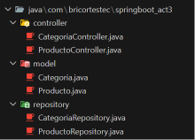

## 4. Modelo de datos y relación entre entidades

El sistema utiliza dos entidades principales:

**Categoria:** almacena el identificador, nombre y descripción de cada categoría.

**Producto:** almacena el identificador, nombre, precio y descripción del producto, además de la categoría a la que pertenece.

La relación implementada es de uno a muchos (One-to-Many): una categoría puede tener varios productos, mientras que cada producto pertenece a una categoría (Many-to-One).

Se utilizan las anotaciones `@OneToMany`, `@ManyToOne` y `@JoinColumn` de Jakarta Persistence para establecer la relación entre ambas entidades.

### Entidad Categoria

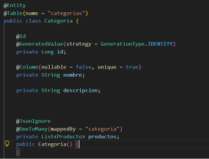

### Entidad Producto

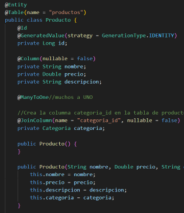

## 5. Operaciones CRUD

La aplicación dispone de los siguientes endpoints REST:

### Categorías

| Método | Endpoint | Descripción |
|---|---|---|
| GET | `/api/categorias` | Consultar todas las categorías |
| GET | `/api/categorias/{id}` | Consultar una categoría por ID |
| POST | `/api/categorias` | Registrar una categoría |
| PUT | `/api/categorias/{id}` | Actualizar una categoría |
| DELETE | `/api/categorias/{id}` | Eliminar una categoría |

### Productos

| Método | Endpoint | Descripción |
|---|---|---|
| GET | `/api/productos` | Consultar todos los productos |
| GET | `/api/productos/{id}` | Consultar un producto por ID |
| POST | `/api/productos` | Registrar un producto |
| PUT | `/api/productos/{id}` | Actualizar un producto |
| DELETE | `/api/productos/{id}` | Eliminar un producto |

### Ejemplo de registro de producto

```json
{
    "nombre": "Laptop",
    "precio": 12500.00,
    "descripcion": "Laptop para trabajo y estudio",
    "categoria": {
        "id": 1
    }
}
```

El producto se registra asociado a una categoría existente mediante su identificador.

### Evidencias de las operaciones en Postman

**Registro de categoría (POST)**

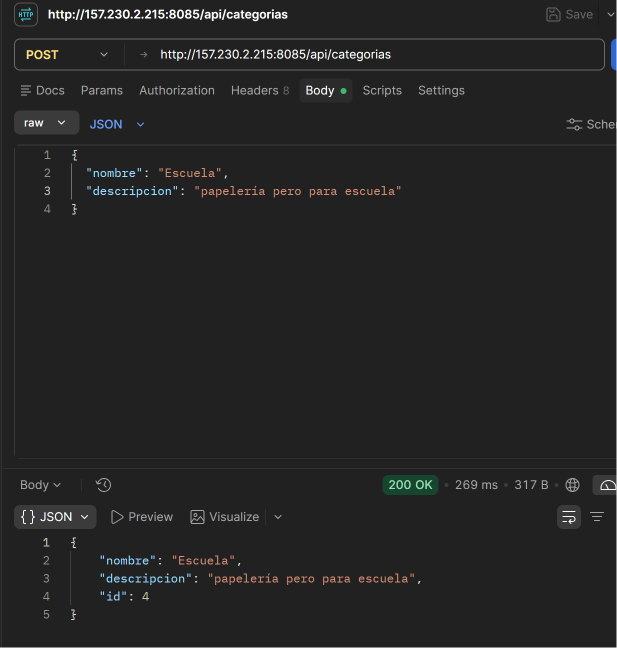

**Consulta de categorías (GET)**

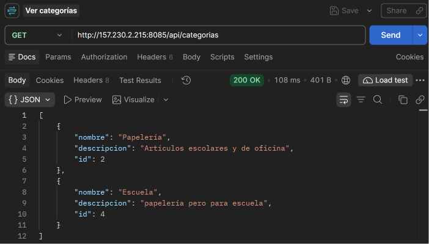

**Registro de producto (POST)**

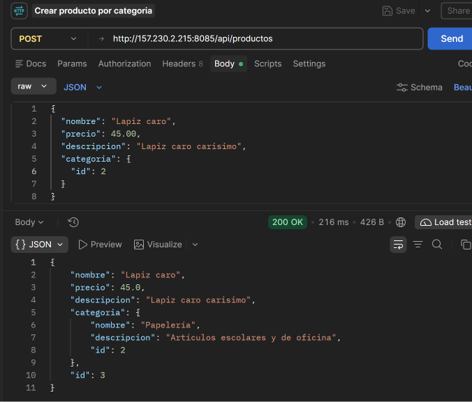

**Consulta de productos y relación con categoría (GET)**

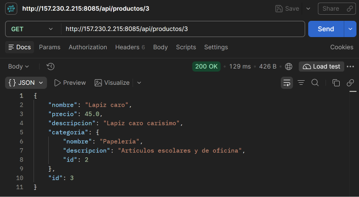

**Actualización de producto (PUT)**

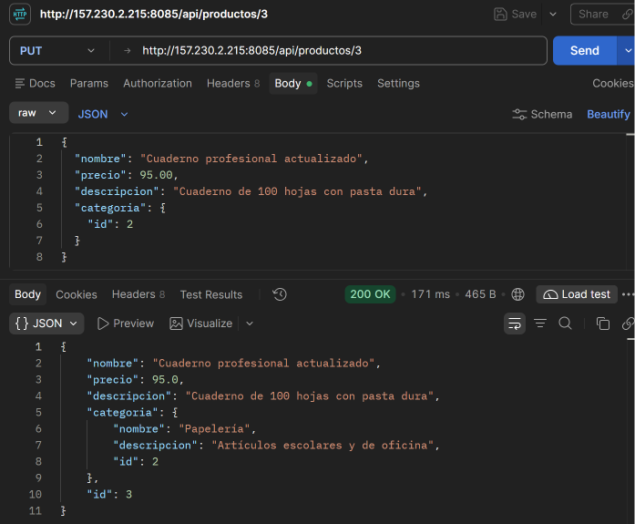

**Eliminación de producto (DELETE)**

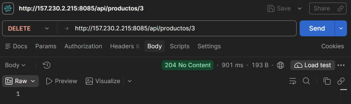

## 6. Interfaz web

Se desarrolló una interfaz web utilizando HTML, CSS y JavaScript, organizados en archivos independientes.

Las páginas disponibles son:

- `index.html`: página principal del sistema.
- `categorias.html`: administración de categorías.
- `productos.html`: administración de productos.

Los estilos se encuentran en `css/estilos.css` y las funciones JavaScript en la carpeta `js/`.

La comunicación con el backend se realiza mediante `fetch()`, consumiendo los endpoints REST de Spring Boot.

### Página principal

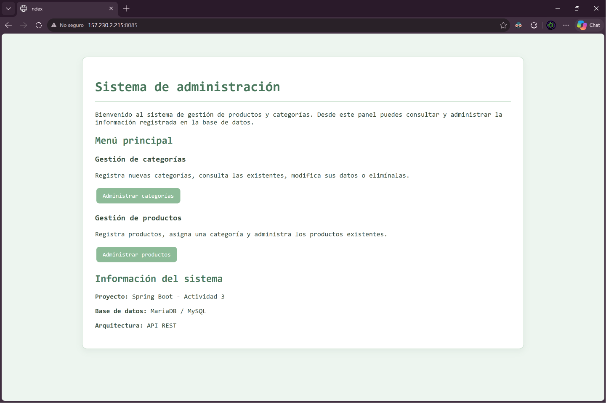

### Administración de categorías

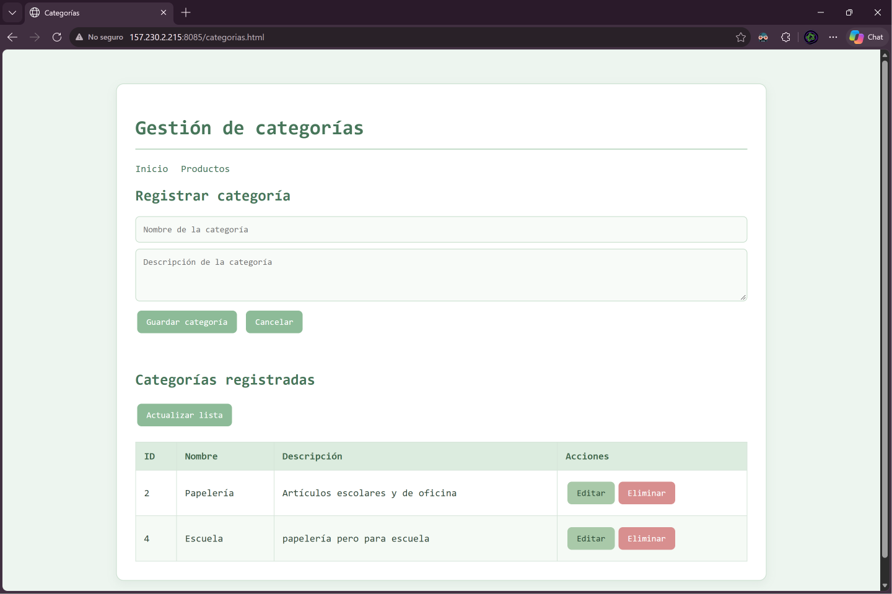

### Administración de productos

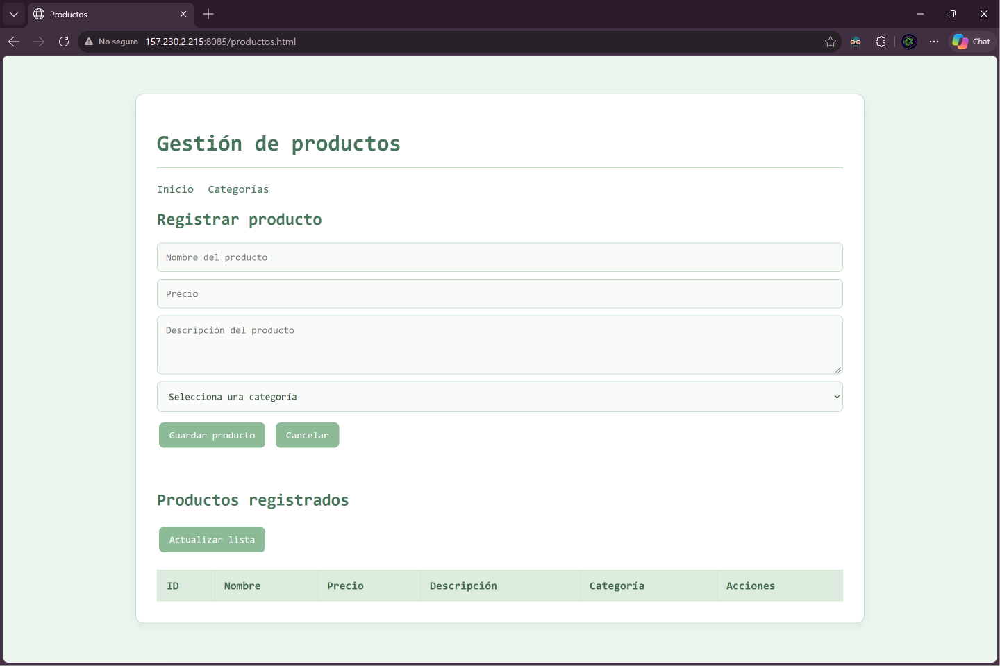

## 7. Base de datos y despliegue

El proyecto utiliza MySQL durante el desarrollo local y MariaDB en el servidor VPS.

**Servidor VPS:** `157.230.2.215`

**Puerto de aplicación:** `8085`

### Acceso al sistema

- Inicio: http://157.230.2.215:8085/
- Categorías: http://157.230.2.215:8085/categorias.html
- Productos: http://157.230.2.215:8085/productos.html

### Endpoints de la API

- http://157.230.2.215:8085/api/categorias
- http://157.230.2.215:8085/api/productos

## 8. Colección de Postman

Se incluye el archivo `Act3-Postman-Collection.json`, que contiene solicitudes HTTP para probar las operaciones CRUD de las entidades Categoria y Producto.

[Consultar colección de Postman](Act3-Postman-Collection.json)

## 9. Repositorio

**GitHub:**

https://github.com/BriCortesTec/HBLCact3_t4

**Aplicación desplegada en VPS:**

http://157.230.2.215:8085/

## 10. Conclusión

Mediante esta actividad se implementó una aplicación utilizando Spring Boot y Spring Data JPA para administrar dos entidades relacionadas mediante una asociación uno a muchos.

Se desarrollaron operaciones CRUD, se realizaron pruebas con Postman y se implementó una interfaz web para interactuar con los servicios REST. Finalmente, el proyecto fue desplegado en un servidor VPS utilizando MariaDB como sistema gestor de base de datos.